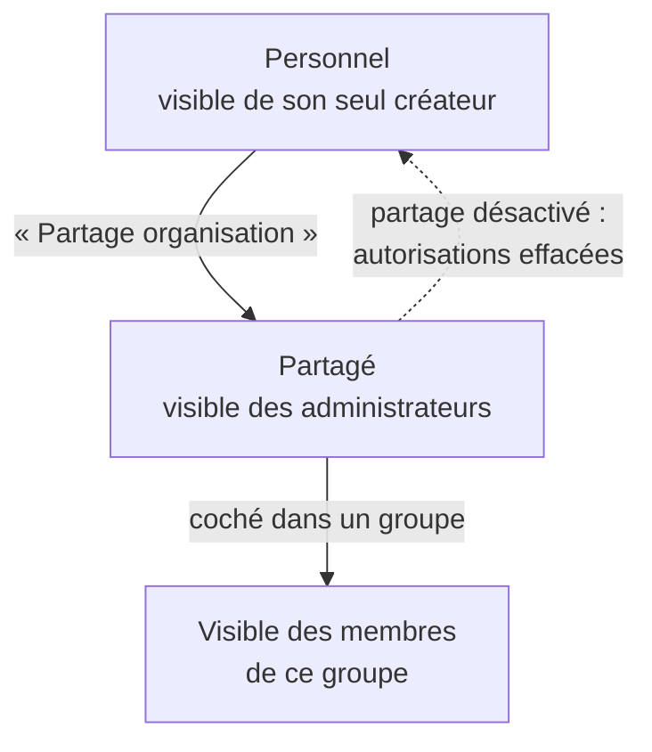

L'administrateur décide **qui voit quel assistant** : tout assistant naît personnel, et c'est vous
qui le distribuez, groupe par groupe. Vous gérez aussi l'ensemble des assistants de l'instance et la
bibliothèque d'avatars, depuis **Espaces → Assistants** : la tuile **Assistants** de la barre
latérale.

## À quoi ça sert

Un bon assistant évite à chacun de réexpliquer son métier à l'IA. Distribué au bon groupe — le
juriste aux RH, le support informatique à tout le monde —, il devient l'outil de travail d'une
équipe. Non distribué, il reste l'essai personnel de son créateur.

## Comment ça marche

**Trois natures, une seule porte de sortie.** Tout assistant, même créé par un administrateur,
naît **personnel** : seul son créateur le voit. Il devient **partagé** quand un administrateur
active **Partage organisation** ; il n'est alors visible que dans les **groupes** où il est
autorisé. L'assistant **global** — visible de tous sans groupe — est réservé à **MIA : mode
d'emploi**, livré avec l'application.

**Qui voit quoi dans le chat.** Un utilisateur voit l'union de :

- ses propres assistants, s'il est créateur ;
- les assistants **partagés et actifs**, autorisés dans **l'un de ses groupes actifs** ;
- l'assistant d'aide.

Un administrateur voit tous les assistants partagés, autorisés ou non. Un assistant **inactif**
n'est visible de personne, pas même de son créateur.

**Le modèle de l'assistant prime sur les droits du groupe.** Un utilisateur dont le groupe
n'autorise pas un modèle peut s'en servir à travers un assistant qui l'impose. C'est voulu : c'est
une façon de donner accès à un modèle coûteux pour un usage précis seulement. Si ce modèle est
désactivé dans MIA, l'assistant bascule sur le modèle par défaut de l'application. Réglé sur
**Défaut application**, un assistant n'impose rien : il suit le modèle par défaut de l'instance et ses
changements, comme une conversation sans assistant — donc dans les limites du groupe de chacun.

**Les créateurs.** Le rôle **Créateur** permet de créer jusqu'à 10 assistants personnels, et de
modifier ceux qu'on a créés — même une fois partagés. Un créateur ne partage pas lui-même.

## Configurer

| Réglage | Où | Effet | Page |
|---|---|---|---|
| **Partage organisation** | Liste des assistants, sur la ligne | Rend l'assistant distribuable | [Distribuer les assistants](distribuer-les-assistants.md) |
| **Droits d'accès → Assistants** | Personnes → Groupes, carte du groupe | Autorise l'assistant pour les membres du groupe | [Distribuer les assistants](distribuer-les-assistants.md) |
| **Actif / Inactif** | Fiche de l'assistant | Le montre ou le cache à tous | [Gérer les assistants](gerer-les-assistants.md) |
| Bibliothèque d'avatars | Liste des assistants, en haut | Les images proposées aux créateurs | [Gérer les assistants](gerer-les-assistants.md) |
| Rôle **Créateur** | Personnes → Comptes | Qui peut créer des assistants | [Gérer les utilisateurs](../utilisateurs/gerer-les-utilisateurs.md) |

Pour créer un assistant, un administrateur suit la même fiche qu'un créateur, sans limite de
nombre : [Créer un assistant](../../fonctionnalites/assistants/creer-un-assistant.md).

## Exemples de configuration

**Un assistant pour tout le monde.** L'assistant *Support IT* est partagé et coché dans le groupe
**★ Par défaut**, qui contient automatiquement tous les comptes.

**Un assistant pour une équipe.** *Juriste RH* est partagé et coché dans le seul groupe *RH*. Les
autres ne le voient pas, même en tapant son nom après **@**.

**Un modèle coûteux, pour un usage précis.** Le groupe *Commerciaux* n'a droit qu'à des modèles
économiques. L'assistant *Réponse aux appels d'offres* impose un modèle plus puissant : les
commerciaux s'en servent à travers lui, et uniquement pour cela.

**Un créateur qui quitte l'entreprise.** Avant de supprimer son compte, vous partagez les assistants
à conserver : sinon, devenus « créés par Système », ses assistants personnels ne sont plus visibles
de personne dans le chat.

## Vérifier que tout fonctionne

Sur la carte du groupe, le compteur **N assistants** augmente. Puis, avec un compte **non
administrateur** membre du groupe, ouvrez la liste **tête de robot** du chat : l'assistant doit y
figurer. Un compte administrateur ne prouve rien, puisqu'il voit tout.

## Voir aussi

- [Les assistants, côté utilisateur](../../fonctionnalites/assistants/index.md)
- [Les utilisateurs et les accès](../utilisateurs/index.md) — groupes et rôles
- [Les modèles de LLM](../modeles/index.md) — les modèles qu'un assistant peut imposer
- [Les outils](../outils/index.md) — les outils qu'un assistant peut appeler
