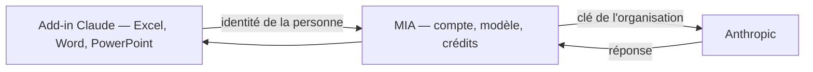

L'add-in officiel **Claude** d'Anthropic, pour **Excel**, **Word** et **PowerPoint**, peut passer par
MIA au lieu d'un compte Claude par personne. MIA reconnaît chacun, relaie ses demandes à Anthropic
avec **la clé de l'organisation** et les compte dans **ses crédits MIA**. Votre organisation ne gère
qu'un outil : MIA. Menu **Administration → Capacités → Connecteurs → Claude dans Office** — la carte
porte les icônes des applications ouvertes.

| Application | Usages typiques |
|---|---|
| **Excel** | Formules, tableaux croisés, graphiques, explication d'un classeur |
| **Word** | Rédaction, relecture, réécriture, résumé d'un document |
| **PowerPoint** | Diapositives faites à partir d'un plan ou d'un document, retouches d'une présentation |

Les trois applications reçoivent **le même add-in**, passent par **la même passerelle** et
s'installent par **un seul manifeste** : vous choisissez celles qui le reçoivent. Outlook n'est pas
couvert (Anthropic le livre par un manifeste à part).

## Avant de commencer

- Une **clé Anthropic** dans **Modèles IA → Fournisseurs et modèles**, et au moins un modèle Claude
  ouvert aux groupes concernés.
- Une instance MIA joignable en **HTTPS** depuis les postes de travail.
- Pour la connexion Microsoft : un administrateur de l'annuaire **Microsoft Entra ID** et un
  administrateur **Microsoft 365** (souvent la même personne).

## Comment ça marche

**Deux façons de reconnaître la personne**, au choix (ou les deux) :

| Façon | Côté DSI | Côté utilisateur |
|---|---|---|
| **Connexion Microsoft** (recommandée) | Régler l'application Entra et déployer l'add-in, **une fois** | Rien : l'add-in s'ouvre avec son compte Microsoft 365 |
| **Jeton personnel** | Rien dans Entra | Générer son jeton dans MIA et le coller une fois dans l'add-in |

Avec la connexion Microsoft, MIA vérifie la **signature** du jeton Microsoft, n'accepte que les
comptes de **votre annuaire**, et rattache la personne à son compte MIA par son adresse. Elle ne crée
jamais de compte : une personne sans compte MIA reçoit un message clair.

**Les mêmes règles que le chat.** Compte actif, droit **Claude dans Office** de son rôle (ouvert par
défaut aux rôles livrés), modèles Claude de ses groupes, quota, budget de l'organisation, comptes de
démonstration. Une réponse refusée ne part pas chez Anthropic.

**Rien n'est gardé.** MIA relaie les demandes et les réponses sans en garder le contenu ; seuls les
jetons consommés vont au grand livre (source « Claude dans Office », une seule pour les trois
applications : l'add-in ne dit pas de laquelle vient une demande). L'add-in échange avec
pivot.claude.ai son interface et des mesures d'usage, sans le contenu. L'historique des échanges
reste dans l'add-in, sur le poste de chacun.

**Ce que la passerelle ne permet pas** (limite d'Anthropic, pas de MIA) : la dictée et le travail
entre plusieurs applications Office. La recherche Internet et l'exécution de code fonctionnent ; la
recherche Internet se coupe dans les réglages.

## Configurer

### 1. Activer, choisir les applications et le mode

**Administration → Capacités → Connecteurs → Claude dans Office** : cochez **Activer la passerelle**,
cochez les **applications qui reçoivent l'add-in** (Excel, Word, PowerPoint — au moins une), choisissez
comment reconnaître chaque personne, puis **Enregistrer**. L'enregistrement est manuel : activer la
passerelle ouvre une dépense.

Seules les applications cochées figurent dans le manifeste. Après un changement, téléchargez-le de
nouveau et redéposez-le dans Microsoft 365 : sa version a changé.

L'**ID d'application** et l'**ID de l'annuaire** reprennent ceux de la connexion Microsoft
(**Organisation → Authentification**) si vous les laissez vides — à condition que l'annuaire y soit
donné par son identifiant (GUID), pas par un nom de domaine.

### 2. Régler l'application dans Entra (connexion Microsoft)

Dans le **centre d'administration Microsoft Entra → Inscriptions d'applications**, sur l'application
de connexion à MIA (ou une nouvelle, pour votre annuaire seulement) :

1. **Authentification → Ajouter une plateforme → Application monopage (SPA)** : les deux adresses de
   retour affichées par MIA, à copier telles quelles.
2. **Exposer une API** : URI d'ID d'application `api://<ID d'application>`, puis une étendue nommée
   comme l'indique MIA (`access_as_user`).
3. **Autorisations d'API → Ajouter → Mes API** : cette application, l'étendue créée (déléguée), puis
   **Accorder le consentement administrateur**.
4. **Manifeste** de l'application : version des jetons d'accès à **2**.

### 3. Déployer l'add-in dans Microsoft 365

Sur la page de MIA, **Télécharger le manifeste**. Puis, dans le **centre d'administration Microsoft
365 → Paramètres → Applications intégrées → Charger des applications personnalisées**, type
**Complément Office**, déposez le fichier et attribuez-le aux utilisateurs ou groupes voulus — un
groupe pilote d'abord. La diffusion prend jusqu'à 24 heures ; l'add-in apparaît alors dans chaque
application cochée, menu **Accueil → Compléments**.

Le manifeste est celui d'Anthropic, complété par l'adresse de MIA et la connexion choisie ; il ne
contient aucun secret. Quand un réglage change, il change de version : redéposez-le.

### 4. Ou laisser chacun utiliser son jeton

En mode **jetons personnels**, chaque personne génère son jeton dans **Réglages → Comptes
connectés**, puis, dans l'add-in, choisit **Cloud provider or gateway**, onglet **Gateway**, colle
l'adresse de la passerelle et son jeton, et clique sur **Continue** — une fois dans chaque
application, le même jeton servant partout. L'add-in vient du manifeste téléchargé, qui lui transmet
l'adresse de MIA, ou de Microsoft Marketplace (**Claude for Microsoft 365**, d'Anthropic) si votre
organisation laisse chacun installer des compléments.

Vous n'avez pas à les former : le pas-à-pas de [Utiliser Claude dans Excel, Word ou
PowerPoint](../../fonctionnalites/connecteurs/claude-dans-office.md) les mène de leur carte MIA à leur
première question, captures d'écran à l'appui, et le bouton **Me guider pas à pas** de leur carte
ouvre l'assistant **MIA : mode d'emploi**, qui le reprend avec eux. Dites-leur seulement si votre
organisation a déployé l'add-in pour eux, ou s'ils l'installent depuis Microsoft Marketplace.

## Vérifier que tout fonctionne

1. Bouton **Tester** de la page : passerelle activée, clé Anthropic, adresse HTTPS, adresse publique
   jointe avec la bonne réponse, annuaire Microsoft trouvé.
2. Avec un compte du groupe pilote : ouvrir chaque application cochée, l'add-in **Claude**, poser une
   question simple (*« résume ce document »* dans Word, *« explique cette formule »* dans Excel).
3. **Coûts → Consommation** : la catégorie **Claude dans Office** apparaît ; le compteur de crédits
   du mois sur la page de MIA augmente.

Les postes doivent joindre **pivot.claude.ai**, **login.microsoftonline.com** et l'adresse de MIA.

## Comment les crédits sont décomptés

Chaque demande de l'add-in est comptée **à son coût réel chez Anthropic**, puis convertie en crédits
avec les mêmes réglages que le chat (**Coûts → Tarifs & crédits**) :

- **Les jetons** du modèle Claude qui a répondu : la question avec le classeur, le document ou les
  diapositives que l'add-in envoie, la réponse, le raisonnement. Le cache lu coûte moins cher, le
  cache écrit plus cher — davantage encore quand l'add-in le garde une heure.
- **Les recherches Internet**, à la recherche, en plus des jetons.
- **Les tarifs majorés** qu'Anthropic applique quand l'add-in les demande : mode rapide, inférence
  aux États-Unis seulement.
- **L'exécution de code** n'est pas comptée : Anthropic l'offre avec la recherche Internet, et
  sinon dans une franchise mensuelle d'heures.

Une demande n'est **pas une réponse** : pour une tâche, l'add-in envoie souvent plusieurs demandes
à la suite (lire les cellules, écrire une formule, vérifier). Le quota de la personne et le budget
de l'organisation sont vérifiés **avant chaque demande** ; une demande en cours se termine.

**Où le lire** : la catégorie **Claude dans Office** (demandes et recherches) dans **Coûts →
Consommation** et dans **Réglages → Usage & crédits** de chaque personne, qui y voit aussi le coût
moyen d'une demande ; la fonctionnalité **Claude dans Office** dans la vue d'ensemble ; les crédits
et le nombre de personnes du mois en tête de cette page. Excel, Word et PowerPoint n'y sont pas
distingués : l'add-in ne dit pas de quelle application vient une demande.

## Exemples de configuration

**Toute l'organisation, sans demande au cas par cas.** Connexion Microsoft seulement, add-in déployé
pour le groupe « Tous les salariés » : chacun l'ouvre dans Excel, Word ou PowerPoint, ses réponses
comptent dans ses crédits MIA.

**Un essai rapide avant d'impliquer la DSI.** Jetons personnels seulement : trois volontaires
génèrent leur jeton et installent l'add-in depuis AppSource. La connexion Microsoft viendra ensuite,
sans rien changer pour eux.

**Excel et PowerPoint seulement.** Décochez Word, téléchargez le manifeste et redéposez-le : l'add-in
disparaît de Word à la diffusion suivante, rien ne change dans les deux autres.

**Pas de recherche Internet dans Office.** Décochez la recherche Internet de l'add-in et redéposez le
manifeste.

## Voir aussi

- [Utiliser Claude dans Excel, Word ou PowerPoint](../../fonctionnalites/connecteurs/claude-dans-office.md), côté utilisateur
- [Autoriser MIA dans Microsoft Entra ID](autoriser-mia-dans-microsoft-entra-id.md)
- [Les connecteurs](index.md)
