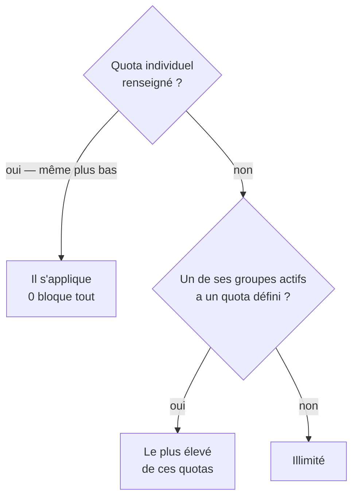

Un quota plafonne la consommation d'une personne sur le mois calendaire. Il se fixe sur l'utilisateur,
sur ses groupes, ou nulle part.

## Avant de commencer

**Les quotas se saisissent en milliers de crédits par mois.** Saisir **20** donne **20 000 crédits**.

**Un budget IA est fixé ?** Sous le champ de quota, un **repère** indique le quota par compte actif
qui garantit de ne jamais l'atteindre — voir [Fixer un budget IA mensuel](fixer-un-budget.md).

## Étapes

- **Sur un groupe** : **Administration → Personnes → Groupes**, carte du groupe, volet
  **Paramètres**, champ **Quota (k crédits/mois)**. Il s'applique à **chaque membre**. Laissé vide, le
  groupe est **neutre** — sa carte affiche « Quota mensuel : aucun (neutre) » : il n'impose rien et
  n'ouvre rien.
- **Sur une personne** : **Administration → Personnes → Comptes**, **Modifier**, champ **Quota mensuel
  (k crédits)**. Le quota ne se règle pas à la création du compte, seulement ensuite.

Un changement vaut dès l'action suivante de la personne.

## Quel quota s'applique

Dans cet ordre :

1. **Le quota individuel**, s'il est renseigné — même plus bas que ceux des groupes. **0 bloque
   tout.**
2. Sinon, **le plus élevé** des quotas **définis** parmi ses groupes **actifs**.
3. Sinon, **illimité**.

Le texte sous le champ de la fiche dit d'où viendra le quota appliqué : « Quota individuel — prime sur
les groupes. », « Vide : hérite du plus généreux des groupes… », « Vide et aucun quota de groupe :
illimité. »

> **Un groupe sans quota n'ouvre rien.** Il est neutre : un membre de *Direction* (sans quota) et de
> *★ Par défaut* (quota 5) est plafonné à 5 000 crédits. Pour libérer une personne, donnez-lui un
> quota individuel élevé.

## Exemples

| Situation | Quota appliqué |
|---|---|
| ★ Par défaut vide, *Support* 20, *Direction* 50 | **50 000** |
| La même, *Direction* devenu inactif | **20 000** |
| La même, avec un quota individuel de 5 | **5 000** |
| ★ Par défaut 10, ses autres groupes vides | **10 000** — pas illimité |
| Aucun quota nulle part | **Illimité** |
| Quota individuel 0 | **Bloqué** dès maintenant |

## Ce que voient les utilisateurs

Sous leur nom, dans la barre latérale : « *N* crédits restants / *total* » — barre orange à 70 %,
rouge à 90 %, « Quota épuisé » à 100 %. Au quota atteint, une fenêtre les invite à contacter un
administrateur ou à attendre le 1er du mois ; leurs demandes, leurs créations et leurs dictées sont
refusées.

La dernière opération avant le blocage peut dépasser légèrement le quota : le contrôle se fait avant
chaque opération.

## Débloquer quelqu'un

1. Le repérer : **Alertes** du tableau de bord — à partir de 80 % —, ou tuile **Quota ≥ 90 %** de la
   page **Comptes**.
2. Relever son **quota individuel**, ou celui d'un de ses groupes, ou l'ajouter à un groupe plus
   généreux. S'il a un quota individuel, changer ses groupes ne sert à rien : c'est l'individuel qui
   s'applique.
3. L'effet est immédiat. Il n'existe ni remise à zéro du compteur, ni recharge ponctuelle.

## En cas de problème

| Ce qui arrive | Quoi faire |
|---|---|
| Une personne est bloquée alors que son groupe a un gros quota | Elle a un quota individuel plus bas, qui prime. |
| Un membre d'un groupe sans quota — « aucun (neutre) » — est plafonné | Un autre de ses groupes a un quota : c'est le plus élevé des quotas **définis** qui s'applique. |
| Le quota semble dix fois trop petit ou trop grand | Les champs sont en **milliers** de crédits. |
