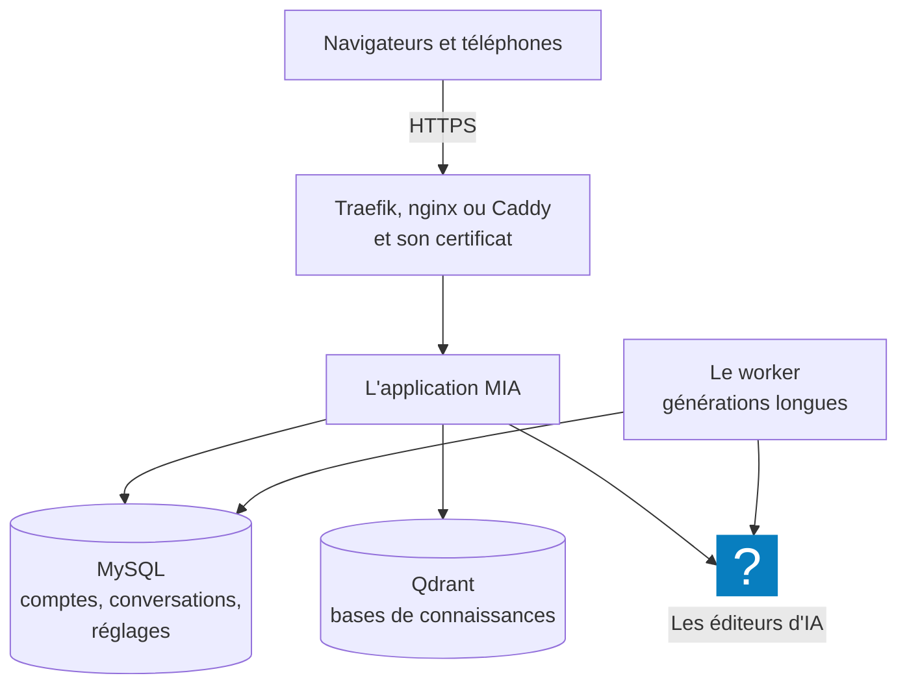

Installer MIA, c'est poser l'application sur un serveur, derrière l'adresse que l'organisation
ouvrira, puis faire dans l'administration les quelques réglages sans lesquels l'assistant ne peut rien
répondre. Un installeur fait la première partie en posant ses questions ; la seconde se fait à l'écran.
Ensuite, une commande installe chaque nouvelle version : c'est ce qui apporte les nouveautés aux
utilisateurs.

## À quoi ça sert

À mettre en service une instance de MIA pour une organisation : son adresse, son premier compte
administrateur, ses clés d'IA et la façon de se connecter. Ces pages s'adressent à la personne qui
installe — chez MyAlfred ou au service informatique du client —, puis à l'administrateur qui prend la
main.

## Comment ça marche

**L'installeur fait tout ce qui se passe sur le serveur.** Il vérifie les prérequis **avant** d'écrire
quoi que ce soit, pose ses questions, écrit la configuration, construit l'application, la démarre,
lance le diagnostic complet et crée le compte administrateur. En cas d'échec, il s'arrête en disant
quoi corriger. Comptez une dizaine de minutes, surtout pour la construction.

**Quatre services tournent ensuite**, chacun dans son conteneur, derrière le proxy qui porte
l'adresse :

- **MIA ne chiffre pas elle-même.** Elle sert du HTTP : c'est le proxy placé devant — un Traefik ou un
  nginx, un Caddy déjà en place sur le serveur — qui détient le certificat et sert l'adresse en HTTPS.
- **Le worker** mène les générations longues — pages web, sites illustrés — hors de la page de
  l'utilisateur, qui peut la quitter sans rien perdre. Sans lui, MIA les mène elle-même, plus
  lentement.
- **MySQL** peut être celle de l'installation, ou une base déjà en service. MIA y crée et y met à jour
  ses tables elle-même, à chaque démarrage.

**Un seul fichier de configuration : `.env`**, écrit par l'installeur dans le dossier de MIA. Il
contient les secrets de l'instance, tirés au hasard — dont la clé qui chiffre les clés d'API
enregistrées : perdue, celles-ci deviennent illisibles. Le fichier reste sur le serveur, lisible par
son seul propriétaire ; gardez-en une copie en lieu sûr, hors du serveur.

**Le dossier de MIA ne se déplace pas.** Docker nomme les données d'après lui : MIA relancée depuis un
autre dossier démarre sur des volumes vides.

**Ce que l'installation ne fait pas.**

| Elle ne fait pas… | Donc |
|---|---|
| Le chiffrement | Un proxy devant MIA, avec son certificat |
| Les sauvegardes planifiées | `./backup.sh` n'est lancé seul qu'avant une mise à jour : planifiez-le |
| L'envoi de mails | MIA n'en envoie aucun. Les comptes se créent dans l'administration, ou à la première connexion par Google ou Microsoft |
| La haute disponibilité | Une seule application ; seul le worker se multiplie |

## Configurer

| Étape | Où | Ce qu'on obtient | Page |
|---|---|---|---|
| Préparer le serveur | Sur le serveur, et chez le gestionnaire du nom de domaine | Docker, l'adresse de MIA, le proxy et ses réglages | [Préparer le serveur](preparer-le-serveur.md) |
| Installer MIA | Sur le serveur : `./install.sh` | MIA en service, le compte administrateur créé | [Installer MIA sur le serveur](installer-mia-sur-le-serveur.md) |
| Faire les réglages de base | Dans MIA : le bouton **Admin**, en bas de la barre latérale, puis le menu de gauche de l'administration | Une clé d'IA, le modèle par défaut, la connexion, les groupes | [Faire les réglages de base](faire-les-reglages-de-base.md) |
| Mettre MIA à jour | Sur le serveur : `./update.sh` | La dernière version, après une sauvegarde automatique | [Mettre à jour MIA](mettre-a-jour-mia.md) |

## Exemples de configuration

**Un serveur qui fait déjà tourner d'autres applications derrière Traefik.** Réponse **2) Derrière
Traefik**, puis le nom de domaine, `mia.exemple.fr`. Traefik obtient le certificat et sert
l'adresse ; MIA n'ouvre aucun port sur le serveur. L'installeur vérifie que le réseau Docker de Traefik
existe, et refuse de continuer sinon.

**Un serveur interne, où un nginx sert déjà les applications de l'organisation.** Réponse **3)
Derrière nginx ou Caddy**, le port 8080, l'adresse publique `https://mia.exemple.fr`. MIA n'écoute
alors que sur le serveur lui-même ; nginx reçoit l'adresse, avec son certificat, et transmet. Il doit
laisser passer le flux des réponses sans le retenir — voir
[Préparer le serveur](preparer-le-serveur.md).

**Une base MySQL déjà en service**, gérée par l'hébergeur. À la question **Hôte MySQL**, son adresse ;
l'installeur demande alors le mot de passe de son utilisateur et n'installe pas de base. La base doit
exister, et son utilisateur avoir le droit d'y créer des tables — voir
[Préparer le serveur](preparer-le-serveur.md).

## Vérifier que tout fonctionne

- Sur le serveur, dans le dossier de MIA : `docker compose exec app php scripts/doctor.php`. Une
  vingtaine de contrôles — base, migrations, worker, Qdrant, modèles disponibles, sortie vers
  Internet… ; chaque ligne en défaut porte son remède.
- Le même diagnostic dans MIA : **Administration → Maintenance → Diagnostic**.
- L'adresse de MIA suivie de `/healthz` répond `"status":"ok"` : c'est la sonde qu'interroge aussi
  Docker.

## Voir aussi

- [Les modèles de LLM](../modeles/index.md), [Les utilisateurs et les accès](../utilisateurs/index.md)
  et [L'instance](../instance/index.md) : le détail des réglages de base.
- [Installer MIA sur ses appareils](../../fonctionnalites/installer-mia-sur-ses-appareils.md) : ce que
  chaque utilisateur installe ensuite, sur son ordinateur et son téléphone.
