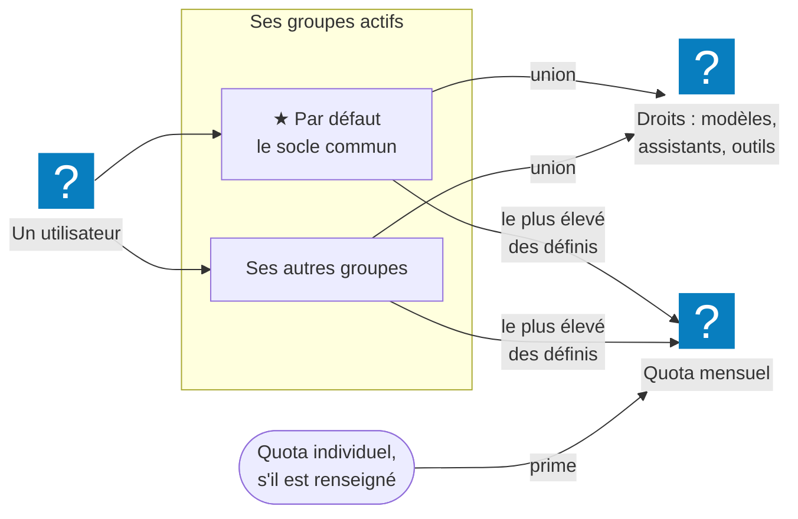

L'administrateur décide **qui entre**, **avec quels droits** et **à quoi chacun a accès**. Quatre
écrans : **Administration → Personnes** (**Comptes**, **Groupes**, **Rôles**), et **Organisation →
Authentification** pour les moyens de connexion.

## À quoi ça sert

À ouvrir MIA aux bonnes personnes, sans gestion au cas par cas : les groupes portent les droits —
modèles, assistants, outils — et les quotas ; les utilisateurs héritent de leurs groupes. Un nouvel
arrivant de l'équipe commerciale rejoint le groupe *Commerciaux* et a aussitôt tout ce qu'il lui faut.

## Comment ça marche

**La connexion.** Trois moyens, activables séparément : Google, Microsoft, e-mail et mot de passe. Un
compte Google ou Microsoft se crée tout seul à la première connexion ; les **domaines autorisés**
limitent qui peut le faire. Les nouveaux comptes sont **activés automatiquement** — c'est le réglage
d'une instance neuve —, ou attendent votre approbation si vous le décidez.

**Un rôle par compte.** Le rôle décide de ce que la personne **peut faire** ; ses groupes, de ce qui
lui est **ouvert**. Trois rôles sont livrés, et chacun contient les droits du précédent :

| Ce que le rôle permet, par défaut | Utilisateur | Créateur | Administrateur |
|---|:-:|:-:|:-:|
| Le chat, les assistants et les outils autorisés par ses groupes | ✓ | ✓ | ✓ |
| Créer des assistants personnels | — | ✓ 10 au plus | ✓ sans limite |
| Créer des bases de connaissances | — | ✓ 5 au plus | ✓ sans limite |
| Distribuer un assistant aux groupes | — | — | ✓ |
| Tout le menu Administration | — | — | ✓ |
| Voir tous les assistants partagés et outils actifs, sans filtre de groupe | — | — | ✓ |

**Personnes → Rôles** règle, case par case, ce que chaque rôle peut voir, utiliser, créer,
modifier, supprimer et gérer — **Gérer** ouvre les assistants et les bases de toute l'organisation, leur
partage et leur portée — et crée des rôles sur mesure : un responsable des comptes, un référent des
assistants, un support en lecture seule. L'administrateur garde tous les droits ; les rôles et les
données lui restent réservés. Voir [Gérer les rôles](gerer-les-roles.md).

**Les groupes portent les droits.** Chaque groupe a trois volets : ses **Paramètres** (nom, quota,
actif), ses **Membres**, et ses **Droits d'accès** — assistants, outils, modèles. Un utilisateur a
l'**union** des droits de ses groupes actifs. Le groupe **★ Par défaut** contient tout le monde : ce
qu'on y coche est le socle commun.

**Les règles qui surprennent**, à connaître avant de configurer :

- **Modèles** : dès qu'un groupe de l'utilisateur a une liste de modèles, il a l'union des listes.
  Si aucun n'en a : membre du seul groupe par défaut, il n'a que le **modèle par défaut** ; membre
  d'un autre groupe actif, il a **tous** les modèles. Un modèle nouvellement activé n'est ajouté à
  aucune liste existante.
- **Quota** : le quota individuel prime, même plus bas. Sinon, c'est le **plus élevé** des quotas
  définis parmi ses groupes actifs. Un groupe sans quota ne rend personne illimité.
- **Connecteurs et dictée** ne se règlent pas par groupe : ils valent pour toute l'instance.

## Configurer

| Réglage | Où | Effet | Page |
|---|---|---|---|
| Moyens de connexion, domaines autorisés, message de la page de connexion | Organisation → Authentification | Qui peut entrer, et comment | [Configurer la connexion](configurer-la-connexion.md) |
| **Activer automatiquement les nouveaux utilisateurs** | Personnes → Comptes, carte **Règles d'accès** | Approbation manuelle ou non | [Gérer les utilisateurs](gerer-les-utilisateurs.md) |
| Rôle, quota individuel, groupes d'un compte | Personnes → Comptes, **Modifier** | Les droits d'une personne | [Gérer les utilisateurs](gerer-les-utilisateurs.md) |
| Ce que chaque rôle peut faire, rôles sur mesure | Personnes → Rôles | Les droits d'un métier | [Gérer les rôles](gerer-les-roles.md) |
| Droits d'accès et quota d'un groupe | Personnes → Groupes | Les droits d'une équipe | [Organiser les groupes](organiser-les-groupes.md) |

## Exemples de configuration

**Tout le monde par Microsoft, sans approbation.** Microsoft activé avec l'ID de votre annuaire,
domaine autorisé `atelier-nord.example`, mot de passe désactivé. Les collaborateurs se connectent
seuls ; personne d'autre ne peut créer de compte.

**Une instance ouverte à des partenaires, sous contrôle.** **Activer automatiquement les nouveaux
utilisateurs** décoché : chaque nouveau compte arrive **inactif**. La tuile **Inactifs** et l'alerte
du tableau de bord signalent les demandes ; vous activez au cas par cas.

**Des droits par métier.** Groupe *★ Par défaut* : un modèle économique, l'assistant *Support IT*,
quota 5. Groupe *Marketing* : en plus, les outils image et vidéo. Groupe *Direction* : les modèles
les plus puissants, quota 50.

**Un stagiaire limité.** Quota individuel de 2 sur son compte : il prime sur les 5 du groupe par
défaut, même si ce dernier est plus généreux.

**Déléguer la gestion des comptes.** Un rôle *Responsable des comptes* — **Comptes** et **Groupes**
cochés dans **Personnes → Rôles** — crée les comptes des nouveaux arrivants et les range dans leurs
groupes, sans accès aux modèles, aux coûts ni aux réglages.

## Vérifier que tout fonctionne

Connectez-vous avec un compte de test **non administrateur** membre du groupe concerné : le
sélecteur de modèle, la liste des assistants et le menu **+** doivent montrer exactement ce que ses
groupes autorisent. Un compte administrateur ne prouve rien pour les assistants et les outils, qu'il
voit tous.

## Voir aussi

- [Les modèles de LLM](../modeles/index.md) — les modèles que les groupes autorisent
- [Les assistants](../assistants/index.md) — distribués par les groupes
- [La gestion des crédits](../credits/index.md) — les quotas, en détail
