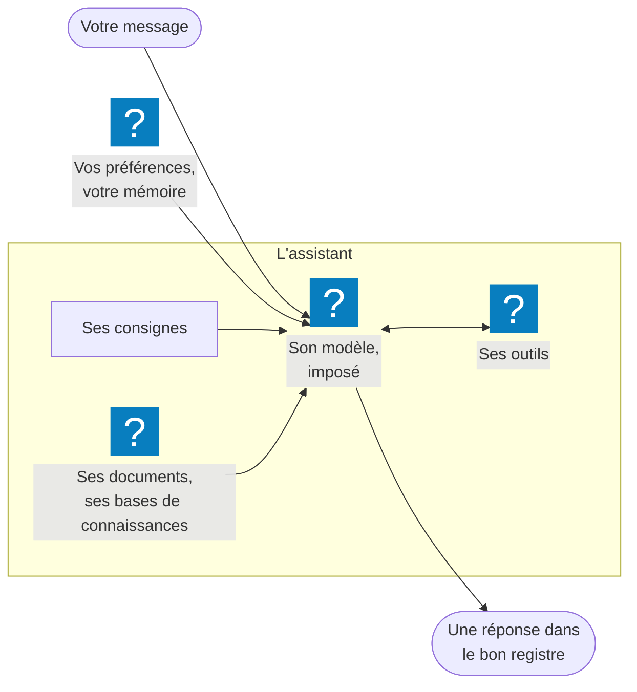

Un **assistant** est une IA préconfigurée pour un usage précis : il porte ses propres consignes,
impose son modèle, et peut s'appuyer sur des documents, des bases de connaissances et des outils.
Vous le choisissez au lieu de régler tout cela vous-même.

## À quoi ça sert

À obtenir d'emblée des réponses dans le bon registre, sans réexpliquer le contexte à chaque
conversation : un juriste qui connaît votre convention collective, un support informatique qui
suit vos procédures, un rédacteur qui respecte votre charte. Celui qui crée l'assistant fait ce
travail une fois ; tous ceux à qui il est distribué en profitent.

## Comment ça marche

**Ce qu'un assistant impose.** Dans une conversation *standard*, vous choisissez le modèle et MIA
répond en généraliste. Avec un assistant :

- ses **consignes** (le prompt système) cadrent chaque réponse : rôle, ton, format, limites ;
- son **modèle** est imposé — le sélecteur de modèle disparaît, le bandeau aussi ;
- ses **documents de référence** et ses **bases de connaissances** sont consultés à chaque message ;
- ses **outils** — images, présentations, automatisations — peuvent être appelés par le modèle
  lui-même.

Vos préférences personnelles et votre mémoire s'ajoutent à ses consignes : voir
[La personnalisation](../personnalisation/index.md).

**Un assistant = une conversation.** Choisir un assistant ouvre toujours une **nouvelle**
conversation, et on ne change pas d'assistant en cours de route : pour en essayer un autre, on
ouvre un autre fil.

**Trois natures d'assistant.**

| Nature | Visible par | Qui la décide |
|---|---|---|
| **Personnel** | Son seul créateur | Tout assistant naît personnel |
| **Partagé** | Les membres des groupes où il est autorisé | Un administrateur |
| **Global** | Tout le monde | Réservé à l'assistant d'aide **MIA : mode d'emploi** |

**Qui peut en créer.** Les comptes **Créateur** créent jusqu'à 10 assistants personnels ; les
administrateurs, sans limite. Un créateur ne partage pas lui-même : il demande à un administrateur
de distribuer son assistant. Ils peuvent aussi le **demander à MIA** dans le chat : elle le compose
et le soumet à leur approbation.

**Si un assistant disparaît** — désactivé, retiré de votre groupe, supprimé —, ses conversations
redeviennent des conversations standard, sans message : l'historique reste, les consignes non.

**Le coût.** Une conversation avec un assistant vous est décomptée au tarif de **son** modèle. Ses
documents et ses bases alourdissent chaque échange : un assistant très documenté coûte un peu plus
par message. Voir [La gestion des crédits](../credits/index.md).

## Les façons de s'en servir

| Vous voulez… | Page |
|---|---|
| Trouver un assistant, démarrer avec lui, savoir ce qu'il sait faire | [Discuter avec un assistant](discuter-avec-un-assistant.md) |
| Créer votre propre assistant *(rôle Créateur)* | [Créer un assistant](creer-un-assistant.md) |
| Décrire l'assistant voulu dans le chat et laisser MIA le composer *(rôle Créateur)* | [Faire créer un assistant par MIA](creer-un-assistant-avec-mia.md) |
| Écrire de bonnes consignes, avec ou sans l'aide de l'IA *(rôle Créateur)* | [Rédiger les consignes d'un assistant](rediger-les-consignes-d-un-assistant.md) |
| Faire générer des images d'après vos propres images — personnage, produit, logo *(rôle Créateur)* | [Faire dessiner un assistant d'après vos images](faire-dessiner-un-assistant-d-apres-vos-images.md) |

## Ce que vous pouvez régler

En tant qu'utilisateur : rien sur l'assistant lui-même. Vous pouvez **ajouter vos propres bases de
connaissances** à la conversation, en plus des siennes — voir
[Les bases de connaissances](../bases-de-connaissances/index.md) —, et allumer un
[connecteur](../connecteurs/index.md), si son modèle le permet.

En tant que créateur : tout, sur vos assistants — voir [Créer un assistant](creer-un-assistant.md).

Les assistants que vous voyez dépendent de vos groupes, fixés par votre administrateur.

## Exemples

**Obtenir une réponse RH fondée sur les accords d'entreprise.** Vous tapez
*« @jur »* puis **Entrée** : l'assistant *Juriste RH* s'engage. Vous demandez *« Combien de jours
de congé pour un déménagement ? »* ; il répond en citant l'accord indexé dans sa base.

**Ouvrir un ticket informatique.** L'assistant *Support IT* suit vos procédures internes ; quand il
propose de créer le ticket, une carte d'approbation vous montre ce qui sera envoyé avant que rien ne
parte.

**Décliner une affiche aux couleurs de la marque.** L'assistant *Studio visuel* a la charte graphique
et les logos dans ses documents : *« une affiche pour le salon de mars, format A3 »* suffit. Il
transmet le logo au moteur d'images, qui le reprend tel qu'il est dessiné — voir
[Faire dessiner un assistant d'après vos images](faire-dessiner-un-assistant-d-apres-vos-images.md).

**Préparer un rendez-vous client** *(créateur)*. Vous décrivez en trois phrases l'assistant voulu
et cliquez **✨ Rédiger avec l'IA** : vous obtenez des consignes structurées, à relire avant de
cliquer **Créer**.

**Faire créer l'assistant par MIA** *(créateur)*. Dans le chat : *« Crée-moi un assistant qui
relit nos contrats fournisseurs, avec la base Juridique »*. MIA vous présente une carte — consignes,
modèle, base, avatar — que vous approuvez, faites corriger ou ajustez dans la fiche complète.

## Voir aussi

- [Les modèles de LLM](../modeles/index.md) — le moteur qu'un assistant impose
- [Les bases de connaissances](../bases-de-connaissances/index.md) — les documents qu'il consulte
- [Les outils](../outils/index.md) — ce qu'il peut produire lui-même
