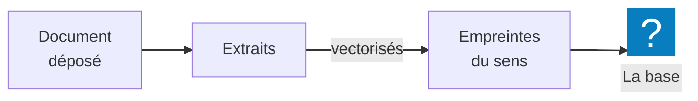
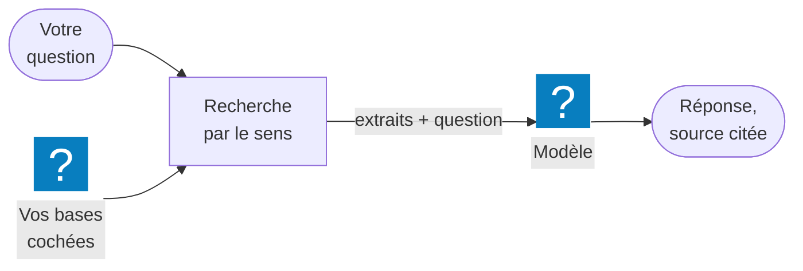

Une **base de connaissances** est une collection de documents — procédures, catalogues, accords,
fiches produits — que MIA consulte avant de répondre. Elle retrouve les passages utiles **par le
sens**, pas seulement par les mots exacts, et fonde sa réponse dessus.

## À quoi ça sert

Un modèle d'IA ne connaît pas vos documents internes. Sans base, il répond de mémoire, en
généraliste, et peut se tromper. Avec une base, il répond **à partir de vos contenus** : la bonne
procédure, le bon tarif, la bonne clause — et le nom du fichier d'où vient l'information.

## Comment ça marche

**À l'alimentation.** Chaque document déposé est lu, découpé en **extraits** de quelques
paragraphes, puis **vectorisé** : chaque extrait reçoit une empreinte numérique de son sens. Une
image est décrite par l'IA, et c'est sa description qui est indexée ; le fichier, lui, reste
disponible pour l'outil image, qui peut le reprendre comme modèle. Tant que ce travail n'est pas
fini pour au moins un document, la base apparaît grisée.

**À chaque message.** Votre question est vectorisée à son tour, et MIA cherche dans chaque base
cochée les extraits les plus proches par le sens. Elle les ajoute à la question envoyée au modèle,
précédés du nom de leur fichier. Le modèle répond en s'appuyant dessus.

**D'où viennent les bases.** Elles sont créées par les **créateurs** et les administrateurs, puis :

- **liées à un assistant**, qui les consulte à chaque message, pour tous ses utilisateurs ;
- ou **partagées** avec des personnes ou des groupes, qui peuvent les cocher dans leurs
  conversations.

**Une base en direct : le cerveau MyBrain.** Un administrateur peut aussi brancher le **cerveau
MyBrain** de l'équipe, le wiki qui se tient à jour à partir des mails et des documents. Rien n'y est
copié : MIA l'interroge en direct à chaque message, et la réponse cite ses fiches. Il ne sert qu'aux
groupes choisis par l'administrateur — même à travers un assistant.

**Trois façons de donner des documents à MIA, trois usages.**

| | Portée | Pour |
|---|---|---|
| Un fichier joint à un message | Ce message | Un document ponctuel, à analyser maintenant |
| Une base de connaissances | Toutes les conversations où elle est cochée ou liée | Un corpus de référence, stable ou synchronisé |
| Le connecteur Google Drive | Votre Drive, lu en direct avec vos droits | Retrouver et lire un fichier précis de votre Drive |

**Les limites.** Trois bases cochées au plus par conversation, en plus de celles de l'assistant.
Une base contient 20 documents déposés à la main, ou jusqu'à 100 fichiers synchronisés depuis un
dossier. Un PDF scanné n'apporte rien : il n'y a pas de reconnaissance de caractères.

**Le coût.** Alimenter une base est décompté **hors quota**, à son créateur. Chaque question posée
avec des bases coûte une petite recherche, comptée dans **votre** quota. Voir
[La gestion des crédits](../credits/index.md).

## Les façons de s'en servir

| Vous voulez… | Page |
|---|---|
| Faire répondre MIA à partir d'une ou plusieurs bases | [Interroger ses bases de connaissances](interroger-ses-bases-de-connaissances.md) |
| Constituer une base et la donner à vos assistants *(créateur)* | [Créer une base de connaissances](creer-une-base-de-connaissances.md) |
| Tenir une base à jour depuis un dossier Google Drive — Drive partagés compris —, OneDrive ou SharePoint *(créateur)* | [Synchroniser une base avec un dossier](synchroniser-une-base-avec-un-dossier.md) |
| Faire répondre MIA à partir du wiki de l'équipe, en citant ses fiches | [Interroger le cerveau MyBrain](interroger-le-cerveau-mybrain.md) |
| Faire entrer un compte rendu ou une décision dans le wiki de l'équipe, après validation | [Proposer un texte au cerveau MyBrain](nourrir-le-cerveau-mybrain.md) |

## Ce que vous pouvez régler

- En conversation : les bases que vous cochez, trois au plus. Certaines peuvent être cochées d'office
  pour votre groupe dans chaque nouvelle conversation ; elles se décochent comme les autres.
- En tant que créateur : tout, sur vos bases — contenu, assistants liés, partage, synchronisation.

Les bases que vous voyez dépendent de ce qu'on vous a partagé. Un utilisateur sans rôle de créateur
reçoit les bases **par ses groupes**.

## Exemples

**Répondre à une question de procédure.** Vous cochez la base *Procédures RH* et demandez *« Quel
délai de prévenance pour un congé sans solde ? »*. MIA répond avec le délai et le document source.
La ligne **Recherche dans les bases de connaissances**, au-dessus de la réponse, nomme la base
interrogée.

**Un catalogue toujours à jour.** Un créateur synchronise la base *Catalogue produits* avec un
dossier Google Drive. Chaque fiche ajoutée au dossier est indexée dans les dix minutes ; l'assistant
*Commercial* répond avec les derniers tarifs, sans que personne ne redépose rien.

**Croiser deux sources.** Dans la même conversation, vous cochez *Catalogue produits* et
*Conditions générales* : *« Quelles garanties sur la gamme Pro, et sous quelles conditions ? »*.

**Des notes de frais scannées.** Déposées en PDF image, elles s'affichent **Sans texte** et la carte
de la base signale des documents à vérifier ; dans le chat, la base reste grisée, **Aucun texte
exploitable dans les documents**. Il faut des fichiers dont le texte est sélectionnable.

## Voir aussi

- [Les assistants](../assistants/index.md) — une base liée à un assistant sert à tous ses
  utilisateurs
- [Les connecteurs](../connecteurs/index.md) — lire un fichier de votre Drive sans l'indexer
- [Les outils](../outils/index.md) — une présentation peut s'appuyer sur vos bases
