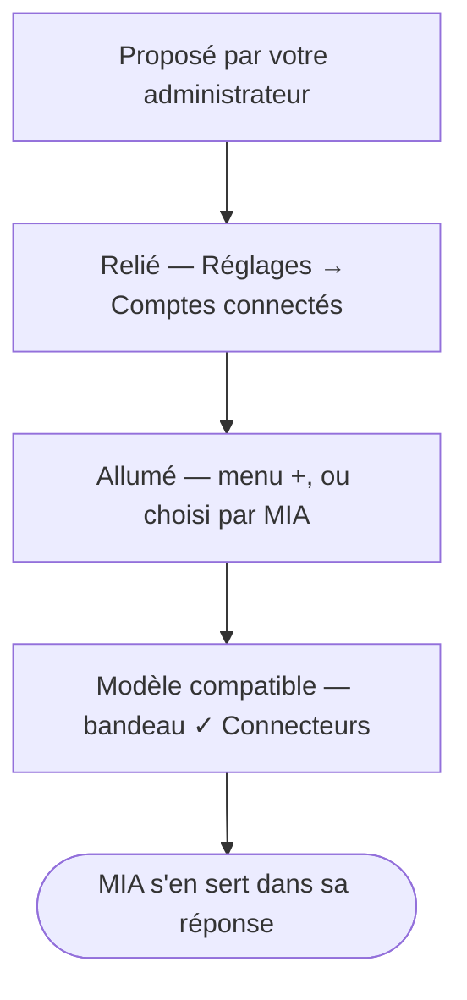

Un **connecteur** relie MIA à une source extérieure : votre Google Drive, votre messagerie Gmail ou
Outlook, vos agendas, vos tâches, vos conversations Slack ou Microsoft Teams — et Internet. Une fois allumé, MIA peut y
chercher, y lire, et préparer des écritures que vous approuvez une à une.

## À quoi ça sert

À travailler sur **vos** données sans copier-coller : *« résume le dernier mail de Paul sur le
devis »*, *« ajoute une conclusion au compte rendu du comité »*, *« qu'ai-je jeudi après-midi ? »*,
*« coche la tâche de relance Leroy »*. MIA va chercher l'information là où elle est, avec vos droits.

## Comment ça marche

**Deux temps : relier, puis allumer.**

1. **Relier** le service, une fois pour toutes, depuis **Réglages → Comptes connectés** : vous autorisez
   MIA auprès de Google ou de Microsoft, avec votre propre compte.
2. **Allumer** le connecteur dans la conversation, depuis le volet **Connecteurs** du menu **+**,
   quand vous en avez besoin.
   Il reste allumé pour vos messages suivants et vos nouvelles conversations, sur ce navigateur,
   jusqu'à ce que vous l'éteigniez.

**Ou laisser MIA choisir.** Avec l'interrupteur **Laisser MIA choisir** du menu **+**, vous n'avez
plus à allumer chaque connecteur avant de poser votre question : MIA allume elle-même, pour la
réponse en cours, un service relié dont votre demande a besoin, et laisse les autres éteints. La pile
d'actions l'indique (« Activation d'un connecteur — Gmail »), et les écritures restent soumises à
votre approbation.

La **Recherche Internet** fait exception : rien à relier, elle est allumée par défaut.

**Quatre conditions** pour qu'un connecteur serve dans une réponse : il est **proposé** par votre
administrateur, votre compte est **relié**, il est **allumé** dans le menu **+** — ou **Laisser MIA
choisir** l'est —, et le **modèle** de la conversation sait s'en servir : le bandeau affiche alors
**✓ Connecteurs**.

**Si une connexion expire**, MIA vous le dit sans bruit : une **pastille ambre** sur votre avatar, une
autre sur l'entrée **Comptes connectés** du menu de vos réglages — son infobulle nomme le service —,
et la ligne du connecteur qui l'annonce dans le menu **+**. Un clic mène à la carte du service, à
reconnecter ou à retirer :
[Relier un service](relier-un-service.md#quand-une-connexion-expire).

**Ce que MIA peut faire, service par service.**

| Connecteur | Consultation | Écriture, toujours soumise à votre approbation |
|---|---|---|
| **Fichiers Google Drive** | Rechercher, lire, parcourir les dossiers | Créer et modifier des Docs et des Sheets, les mettre en forme, dupliquer, renommer, déplacer |
| **Emails Gmail** | Rechercher et lire vos mails **et leurs pièces jointes** | Préparer un **email**, nouveau ou en réponse, que vous enregistrez en brouillon ou **envoyez** d'un clic |
| **Emails Outlook** | Rechercher et lire vos mails **et leurs pièces jointes** | Préparer un **email**, nouveau ou en réponse, que vous enregistrez en brouillon ou **envoyez** d'un clic |
| **Agenda Google** | Consulter vos agendas, trouver un **créneau libre** | Créer un évènement ; les participants sont ajoutés sans invitation envoyée |
| **Agenda Outlook** | Consulter vos agendas, trouver un **créneau libre** | Créer un évènement, sans participant |
| **Tâches Google** | Lister vos tâches | Ajouter, modifier, cocher, supprimer — suppression désactivable |
| **Tâches Microsoft To Do** | Lister vos tâches, lire leurs notes et leurs étapes | Ajouter, modifier, cocher, poser un **rappel à une heure** — jamais de suppression |
| **Messages Slack** | Rechercher, lire un canal, dérouler un fil | Publier un message en votre nom, nouveau ou en réponse — **visible aussitôt** |
| **Messages Teams** | Rechercher, lire une conversation ou un canal, dérouler un fil | Publier un message en votre nom dans une conversation, un canal ou un fil — **visible aussitôt** |
| **Recherche Internet** | Chercher sur le web public, **lire une page** dont vous donnez l'adresse | — |

**Aucun email ne part sans votre clic** : MIA n'a aucun outil d'envoi, seul le bouton **Envoyer** de la
carte de relecture envoie, après votre confirmation.
**Aucun fichier n'est jamais supprimé.** Les **pièces jointes** des mails (PDF, Word, Excel, PowerPoint,
texte) se lisent quand votre question porte dessus ; une image ou un ancien format .doc ne se lit pas,
et MIA le dit. Un long document se lit **en entier, partie par partie**.

**Les heures sont les vôtres.** Les agendas, et les échéances et rappels de Microsoft To Do, se lisent et s'écrivent à l'heure de votre appareil : un
évènement demandé « demain à 14 h » est créé à 14 h chez vous, et la carte d'approbation nomme le
fuseau. Pour un **créneau libre**, MIA tient compte aussi des disponibilités des collègues que vous
nommez, quand leur agenda lui est visible (même organisation, ou agenda partagé) — sans jamais en
voir le contenu.

**Deux écritures sont immédiates et sans retour.** Un message Slack approuvé n'est pas un brouillon :
il **part dans le canal** et devient visible de tous ses membres — MIA ne peut ensuite ni le modifier
ni le supprimer, et ne voit jamais un canal privé dont vous n'êtes pas membre. Un email **envoyé**
depuis sa carte part de même, à ses destinataires ; c'est pourquoi le bouton demande confirmation.

**Toute écriture passe par votre approbation.** MIA ne modifie rien pendant qu'elle répond : elle
dépose une **carte d'approbation** — l'action exacte, l'objet visé, ses conséquences, un aperçu —,
et rien n'est fait tant que vous n'avez pas cliqué **Approuver**. Quand plusieurs cartes attendent,
**Tout approuver** et **Tout refuser** les tranchent d'un coup, emails exceptés. Sans réponse, la
carte expire au bout de 30 minutes — une semaine pour une carte préparée par une
[tâche programmée](../conversations/programmer-une-tache.md). Pour un email, la carte montre le message tel qu'il partira et vous laisse le
**modifier**, le faire **améliorer** par MIA ou l'**abandonner** avant de créer le brouillon ou de
l'**envoyer**.

**La carte dit d'après quoi.** Si MIA a lu des mails, des documents ou des messages avant de
préparer une action, la carte les nomme sous « Préparé après la lecture de : ». Ces contenus sont
écrits par d'autres que vous : vérifiez que l'action correspond bien à **votre** demande, et pas à
une phrase glissée dans un mail.

**Une question, toutes les sources.** Avec plusieurs connecteurs allumés, *« qu'avons-nous sur le
dossier Durand ? »* interroge toutes les sources en même temps — mails, Drive, Slack, agendas, tâches,
bases de connaissances — et la réponse cite d'où vient chaque élément. Gmail et Outlook, ou vos deux
agendas, se consultent aussi d'un seul coup. Une source en panne est nommée ; les autres répondent.

**MIA garde le fil.** Un mail, un document ou un évènement qu'elle vient d'ouvrir peut être désigné
sans le renommer : *« réponds à ce mail »*, *« ajoute-lui une conclusion »*.

**Le coût.** Google et Microsoft ne coûtent rien ; ce qui compte, ce sont les tokens du modèle, qui
relit ce qu'il a trouvé, et chaque recherche Internet. Voir
[La gestion des crédits](../credits/index.md).

## Les façons de s'en servir

| Vous voulez… | Page |
|---|---|
| Autoriser MIA à accéder à votre Drive, votre messagerie, vos agendas ou vos tâches | [Relier un service](relier-un-service.md) |
| Faire chercher, lire ou préparer un brouillon dans une conversation | [Utiliser un connecteur](utiliser-un-connecteur.md) |
| Résumer un canal Slack, ou y publier un message | [Travailler avec Slack](travailler-avec-slack.md) |
| Résumer une conversation ou un canal Microsoft Teams, ou y publier un message | [Travailler avec Microsoft Teams](travailler-avec-teams.md) |
| Faire vérifier une information en ligne | [Rechercher sur Internet](rechercher-sur-internet.md) |

## Ce que vous pouvez régler

- Les services que vous reliez, et ceux que vous déconnectez.
- Les connecteurs allumés dans chaque conversation, ou **Laisser MIA choisir** pour qu'elle les
  allume elle-même au besoin.
- Pour Google Tasks : votre liste par défaut, la fenêtre d'échéance, et l'autorisation de supprimer
  des tâches.

Les connecteurs proposés dépendent de votre administrateur : un connecteur qu'il masque disparaît du
menu **+** pour toute l'organisation.

## Exemples

**Répondre à un mail sans quitter MIA.** Vous allumez **Emails Gmail** : *« résume le dernier mail
de Paul Durand sur le devis »*, puis *« réponds-lui qu'on valide »*. La carte annonce « Répondre à
un email (brouillon Gmail) » et montre la réponse entière ; un clic sur *Plus chaleureux* la
réécrit, vous cliquez **Créer la réponse en brouillon**, et le brouillon attend dans Gmail, prêt à
être envoyé par vous.

**Compléter et ranger un document.** Avec **Fichiers Google Drive** : *« ajoute une conclusion au
compte rendu du comité du 12 mars »*, puis *« déplace-le dans Clients / Durand »*. Deux cartes, deux
approbations.

**Préparer sa semaine.** Avec **Agenda Outlook** et **Tâches Google** : *« liste mes rendez-vous de
la semaine et les tâches qui arrivent à échéance »*.

**Ne rien oublier.** Avec **Tâches Microsoft To Do** : *« ajoute "Relancer Durand" pour vendredi,
rappel jeudi à 9 h »*. La carte nomme la liste, l'échéance et l'heure du rappel ; une fois approuvée,
c'est To Do qui vous prévient jeudi.

**Ne rien allumer d'avance.** **Laisser MIA choisir** allumé, rien d'autre : *« retrouve le devis
Durand dans mes mails et ajoute une tâche de relance pour vendredi »*. MIA active Gmail, puis Tâches
Google ; la pile d'actions le montre, et la tâche attend votre approbation. À *« merci ! »*, elle
n'active rien.

**Vérifier une information récente.** **Recherche Internet** allumée, modèle **✓ Internet** : *« quel
est le taux du livret A ce mois-ci ? »* — MIA cherche avant de répondre.

**Caser une réunion.** Avec **Agenda Google** : *« trouve une heure libre jeudi ou vendredi avec
marie@exemple.fr »*. MIA propose des créneaux communs, puis, sur votre accord, prépare l'évènement à
approuver.

**Lire la facture jointe.** Avec **Emails Outlook** : *« que dit la facture jointe au dernier mail
d'Orange ? »*. MIA ouvre le mail, lit le PDF joint et cite son montant.

**Rattraper une discussion.** Avec **Messages Slack** : *« résume #projet-x depuis hier »*, puis
*« préviens le canal que la livraison passe à jeudi »*. La carte d'approbation rappelle que le
message partira vraiment ; vous approuvez, il est publié en votre nom.

## Voir aussi

- [Les modèles de LLM](../modeles/index.md) — presque tous savent utiliser les connecteurs ; le bandeau ✓ Connecteurs le dit
- [Les bases de connaissances](../bases-de-connaissances/index.md) — indexer un dossier Drive plutôt
  que le lire à la demande
- [Les outils](../outils/index.md) — produire, plutôt que consulter
