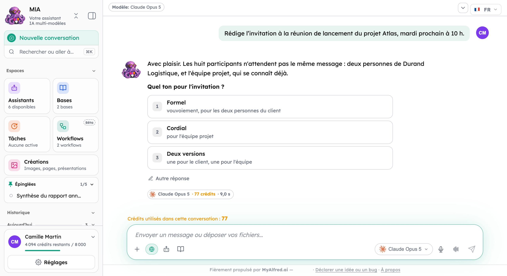

C'est l'usage quotidien de MIA : poser une question, obtenir une réponse, rebondir. Comment une
conversation fonctionne : [Les conversations](index.md).

## Démarrer

Quatre façons, au choix :

1. **Écrire directement** dans le champ de saisie de l'écran d'accueil ;
2. taper **@** suivi des premières lettres du nom d'un assistant ;
3. cliquer l'icône **tête de robot** sous le champ de saisie ;
4. cliquer **+ Nouvelle conversation** dans la barre latérale.

Sur téléphone, la zone de saisie montre deux lignes (trois sur l'écran d'accueil) et grandit avec votre
texte jusqu'à près de la moitié de l'écran.

## Des idées dans la zone de saisie

Tant que la zone de saisie est vide, son texte d'aide laisse place, en fondu, à des **idées
d'utilisation** : « Résume ce document en cinq points clés », « Prépare une réponse au dernier email de
mon client »… Elles ne citent que ce que **vous** pouvez faire : un connecteur n'y apparaît qu'une fois
relié dans **Réglages → Comptes connectés**, un outil que s'il vous est ouvert et en service, une tâche
programmée ou un workflow que si votre rôle permet d'en créer. Elles disparaissent dès la première
lettre tapée. Avec le réglage du système « réduire les animations », elles passent en simple fondu.

Ces idées ne servent qu'à **démarrer** : dès que la conversation est lancée, elles s'arrêtent et le
champ ne montre plus que son texte d'aide — ou la suite proposée par MIA.

## Une suite proposée après chaque réponse

Quand MIA a répondu, la zone de saisie vide vous propose en grisé **la suite logique** de l'échange :
« Oui, prépare le brouillon pour Marie » quand MIA vient de le proposer, « Compare avec le devis de
l'an dernier » après une analyse, « Mets ces chiffres dans un tableau Excel »…

- Appuyez sur **Tab** pour la reprendre : elle s'écrit dans le champ, **rien n'est envoyé**. Modifiez-la
  si besoin, puis **Entrée**. Au doigt, touchez **Utiliser**.
- Elle ne gêne pas : tapez autre chose, elle disparaît ; videz le champ, elle revient.
- Elle n'apparaît que sous la **dernière** réponse, une fois celle-ci terminée — ni pendant l'écriture,
  ni quand une carte attend votre décision, ni quand MIA vous propose déjà des choix en boutons ou le
  bouton **Continuer**. Quand aucune suite n'est évidente, rien ne s'affiche.
- Elle est préparée **une fois par réponse** par le modèle de la conversation, puis retrouvée telle
  quelle si vous rechargez la page. Elle coûte quelques crédits (*Assistance de conversation*). En
  rouvrant une conversation ancienne, aucune n'est préparée.

## Raccourcis clavier

| Touche | Action |
|---|---|
| **Entrée** | Envoyer |
| **Maj + Entrée** | Saut de ligne |
| **@** | Appeler un assistant |
| **Tab** | Reprendre la suite proposée par MIA (champ vide) |
| **↑ / ↓** | Parcourir la liste des assistants |
| **Échap** | Fermer une fenêtre ou la liste |

Pour envoyer avec **Ctrl + Entrée** (**⌘ + Entrée** sur Mac) et garder **Entrée** pour aller à la ligne,
voir [Régler l'affichage](../personnalisation/regler-l-affichage.md).

## Suivre ce que fait MIA

Votre message s'affiche à l'instant de l'envoi. Tant que MIA réfléchit ou cherche, trois points animés, aux
couleurs de votre organisation, se rejoignent à côté de ce qu'elle fait : « En réflexion… », « Recherche dans vos emails
Gmail… ». La réponse s'écrit ensuite lettre à lettre ; si elle marque une pause, le curseur reste au bout du
texte et pulse doucement. **Copier**, **Regénérer** et les exports apparaissent une fois la réponse terminée.

Si votre appareil demande de réduire les animations, le texte apparaît par paquets et les trois points restent immobiles.

Au-dessus de chaque réponse, une pile grise liste ce que MIA a consulté avant de répondre :
« Recherche sur Internet », « Lecture d'un document Google Drive »… Les lignes s'empilent en direct et
restent visibles dans l'historique. Une action en échec s'affiche en ambre.

Cette trace est informative : elle n'est jamais reprise dans **Copier** ni dans les exports.

## Répondre à un choix proposé

Quand la suite dépend d'une décision de votre part — une piste parmi plusieurs, un ton, un format, la
prochaine étape —, MIA peut terminer sa réponse par des **boutons** : la question, puis une option par
bouton. Elle ne le fait que lorsque c'est utile, jamais pour une question ouverte.

- **Un clic envoie l'option** comme votre réponse, comme si vous l'aviez tapée. Le texte en cours de
  rédaction et les pièces jointes en attente restent dans la zone de saisie.
- **« Plusieurs choix possibles »** : cochez les options voulues, puis **Envoyer**.
- **Rien ne vous oblige à choisir** : écrivez votre propre réponse — **Autre réponse** place le curseur
  dans la zone de saisie. Dès que vous avez répondu, les boutons se figent et l'option envoyée reste
  cochée.
- Au clavier : les **flèches** passent d'une option à l'autre, **1** à **9** choisissent l'option de ce
  rang.

Seuls les boutons de la dernière réponse sont actifs. Il n'y en a pas en conversation vocale, ni dans les
réponses d'une tâche programmée ou d'un workflow, qui se déroulent sans vous.

## Images venant d'un autre site

Une image hébergée par un autre site n'est pas affichée d'office : à sa place, un bouton
**Image externe · nom du site — Afficher**. Une image se charge d'elle-même dès qu'elle est affichée,
et son adresse peut transporter des informations vers le site qui l'héberge : c'est vous qui décidez.
Un clic l'affiche pour le reste de la page. Les images créées par MIA s'affichent normalement.

**Copier** et les exports PDF ou Word remplacent une image externe par un lien vers son adresse.

## Reprendre la main

- **Arrêter la génération** remplace le bouton d'envoi pendant la réponse. Un clic l'arrête
  sur-le-champ : le texte cesse de s'écrire, la réponse est marquée « Réponse interrompue » et le
  bouton d'envoi revient. C'est cette réponse, telle que vous l'avez vue, qui reste dans la
  conversation. Pour une image ou une page web, le bouton affiche « Arrêt en cours… » le temps que
  la génération se termine — un appel déjà parti chez le fournisseur va parfois à son terme.
- **Vous pouvez partir.** Une génération lancée continue sur le serveur : changez de conversation,
  rechargez la page, fermez l'onglet — rien n'est perdu. Le résultat vous attend dans sa conversation.
- Un bandeau « *N* génération(s) en cours » apparaît sous le bouton **Rechercher ou aller à…**, avec **Voir** et
  **Arrêter** pour chaque génération. Il reflète aussi ce que vous avez lancé depuis un autre appareil.
- **🔔 M'avertir quand c'est terminé** demande l'autorisation d'afficher une notification système.

## Demander à MIA de se souvenir — ou d'oublier

Dites-le en conversation : *« Souviens-toi que je préfère les réponses courtes »* — ou *« retiens »*,
*« mémorise »*, *« remember that »*. MIA range l'information dans votre **Mémoire** et la retrouve
dans toutes vos conversations, quel que soit l'assistant. Pour corriger : *« corrige ta mémoire :
… »* ; pour faire oublier : *« oublie que… »*. Une pastille sous la réponse dit ce qui a changé ;
après un retrait, **Annuler** le remet.

MIA apprend aussi d'elle-même, quelques minutes après la conversation, ce que vous y dites de vous
(votre métier, la forme de réponse que vous préférez, vos outils) ; une carte **MIA apprend à vous
connaître** vous prévient avant, avec le choix de refuser. Ce qu'elle déduit — ou note pendant la
réponse avec ses outils — attend votre confirmation avant de servir. Elle refuse un mot de passe ou un
numéro de carte. Voir [Gérer sa mémoire](../personnalisation/gerer-sa-memoire.md).

De temps en temps, sous une réponse terminée, une carte **Question de MIA** vous demande ce que vous
préférez (la forme des réponses, votre façon de travailler, vos outils). Un clic répond ; **Passer**
la retire. Jamais deux dans une même conversation.

## Retrouver une ancienne conversation

Faites allusion à un échange passé : *« reprends le plan de la dernière fois »*, *« tu m'avais
conseillé un outil, lequel ? »*. MIA cherche dans **vos autres conversations** — jamais dans celles
des autres — et cite celle d'où vient l'information, avec un lien pour la rouvrir. La ligne
**Recherche dans vos anciennes conversations** l'indique dans la pile d'actions. Si rien ne
correspond, elle vous le dit plutôt que d'inventer. Il faut un modèle **✓ Connecteurs**.

## Les suggestions au fil de la frappe

MIA lit votre message pendant que vous l'écrivez et propose parfois une bannière : activer un outil
de génération, rallumer la recherche Internet, ou autoriser l'accès à vos données Google ou Outlook.

- **Utiliser …** active l'outil, **Activer …** allume le connecteur, exactement comme si vous
  l'aviez choisi vous-même. Rien n'est envoyé.
- **Non merci** fait disparaître cette suggestion jusqu'à la fermeture de l'onglet.
- Envoyer sans répondre à la bannière n'a aucune conséquence.

Aucune suggestion n'apparaît si des fichiers sont joints, ni d'outil si un outil est déjà actif.

## Un outil reste actif tant que vous ne l'éteignez pas

Activer un outil de génération engage **toute la conversation**, pas un seul message. Sa pastille le
rappelle à côté du bouton **+**. Vous affinez donc votre production message après message — voir
[Les outils](../outils/index.md).

Pour poser une question ordinaire, retirez d'abord la pastille en cliquant sa **croix** : tant qu'un
outil est actif, chaque message part vers cet outil.

## En cas de problème

| Ce qui arrive | Quoi faire |
|---|---|
| « Analyse de votre demande… » reste affiché longtemps | Patienter : certains modèles réfléchissent avant d'écrire. Si rien ne vient, **Arrêter la génération**, puis renvoyer ou changer de modèle. |
| Un encadré ⚠️ d'erreur | Son titre dit la cause : voir [Choisir un modèle](../modeles/choisir-un-modele.md). |
| L'envoi est bloqué | Votre quota est probablement atteint. Voir [Suivre sa consommation](../credits/suivre-sa-consommation.md). |
