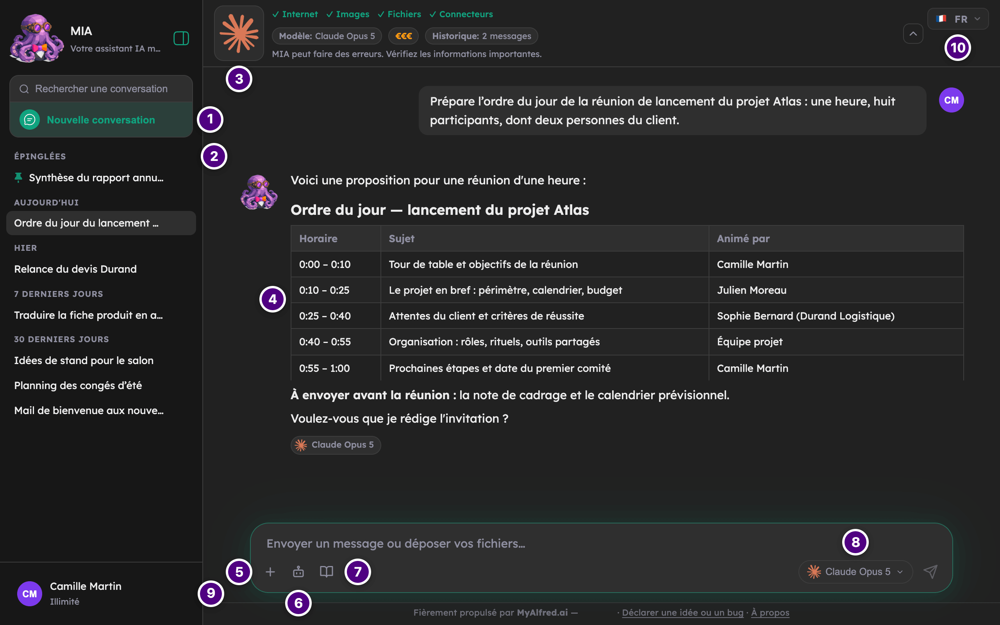

## Avant de commencer

L'adresse de MIA, fournie par votre administrateur, et votre compte professionnel.

## Se connecter

La page de connexion propose jusqu'à quatre moyens d'entrer. **Votre administrateur choisit ceux qui
sont affichés** : il est normal de n'en voir qu'un ou deux.

1. **Continuer avec Google**
2. **Continuer avec Microsoft**
3. **E-mail + mot de passe**
4. **Connexion admin locale**, repliée sous un lien, réservée au dépannage

Google et Microsoft mènent au **même compte MIA** quand les deux portent la même adresse et que
votre organisation est reconnue par l'instance : vous retrouvez vos conversations dans les deux cas.
Sinon, MIA refuse de rattacher la seconde connexion plutôt que de risquer une confusion de comptes.

## Poser sa première question

Écrivez dans le champ **Envoyer un message ou déposer vos fichiers…**, au centre de l'écran d'accueil,
puis **Entrée**. La conversation se crée toute seule et son titre est généré après votre premier
message.

La réponse s'affiche au fil de l'eau. Sous chaque réponse, une étiquette indique le modèle utilisé,
les crédits consommés et le temps de réponse — voir [Les modèles de LLM](fonctionnalites/modeles/index.md)
et [La gestion des crédits](fonctionnalites/credits/index.md).

## Résultat

Votre conversation apparaît dans la barre latérale gauche, classée par date. Vos crédits restants
sont affichés en bas de cette barre.

## Se repérer dans MIA

C'est l'écran que vous retrouvez en ouvrant une conversation depuis la barre latérale. Chaque numéro
renvoie au sujet qui explique la zone en détail.

| | À l'écran | Le sujet |
|---|---|---|
| **1** | **Nouvelle conversation** ouvre un fil vierge ; son titre se génère après votre premier message. Juste dessous, dans le même bloc, **Rechercher ou aller à…** : une seule barre pour retrouver une page, une action ou une conversation (**⌘K**, ou **Ctrl+K** sur Windows et Linux, l'ouvre depuis n'importe où). Plus bas, la rangée **Espaces** : des tuiles qui ouvrent vos pages de travail — **Tâches** et **Créations** pour tous, et selon vos droits **Assistants**, **Bases** et **Workflows** —, et la tuile **Tout**, qui ouvre la même barre. | [Les conversations](fonctionnalites/conversations/index.md) |
| **2** | Vos conversations, les **épinglées** en tête, puis par date ; une pastille de couleur rappelle l'assistant d'une conversation. Le bouton **⋯** d'une conversation la renomme, l'épingle ou la supprime. | [Les conversations](fonctionnalites/conversations/index.md) |
| **3** | Le **bandeau** : le modèle choisi, ce qu'il sait faire — **Internet**, **Images**, **Fichiers**, **Connecteurs** —, son coût relatif et le nombre de messages d'historique envoyés. | [Les modèles de LLM](fonctionnalites/modeles/index.md) |
| **4** | La **réponse**, mise en forme — titres, listes, tableaux. L'étiquette dessous nomme le modèle qui l'a rédigée ; au survol, **Copier**, **Regénérer** et l'export PDF ou Word. | [Les conversations](fonctionnalites/conversations/index.md) |
| **5** | **+**, **Fichiers, outils et connecteurs** : joindre un document, créer une image ou une présentation, consulter vos services Google ou Microsoft. | [Les connecteurs](fonctionnalites/connecteurs/index.md), [Les outils](fonctionnalites/outils/index.md) |
| **6** | **Démarrer une conversation avec un assistant** : une IA préconfigurée, qui impose son modèle, ses consignes et ses sources. | [Les assistants](fonctionnalites/assistants/index.md) |
| **7** | Les **bases de connaissances** que MIA interroge pour cette conversation. | [Les bases de connaissances](fonctionnalites/bases-de-connaissances/index.md) |
| **8** | **Choisir le modèle LLM** : le moteur qui rédige la prochaine réponse. | [Les modèles de LLM](fonctionnalites/modeles/index.md) |
| **9** | Votre nom et vos **crédits restants** — ici **Illimité**. Dessous, le bouton **Réglages** mène à vos réglages personnels ; pour qui administre, le bouton **Admin** mène à l'**Administration**, avec une pastille qui compte les points à régler. | [La gestion des crédits](fonctionnalites/credits/index.md), [La personnalisation](fonctionnalites/personnalisation/index.md) |
| **10** | La **langue** de l'interface : **🇫🇷 FR** ou **🇬🇧 EN**. | [Changer la langue](fonctionnalites/personnalisation/changer-la-langue.md) |

### Où trouver quoi

- **Vos conversations et vos espaces de travail** : la barre latérale. Ses tuiles **Espaces** ouvrent
  vos **Tâches programmées**, **Mes créations** et, selon vos droits, les **Assistants**, les **Bases de
  connaissances** et les **Workflows** ; ces pages gardent la barre latérale, pour revenir d'un clic à
  une conversation.
- **Vos réglages personnels** : le bouton **Réglages**, en bas de la barre latérale. Il mène
  directement à la page **Mon profil**, où se lit aussi votre **rôle**. Le menu de gauche réunit, sous
  **Mon compte**, **Mon profil**, **Préférences IA**, **Affichage**, **Comptes connectés** et **Usage &
  crédits**, puis, plus bas, **À propos de MIA** et **Se déconnecter**.
- **L'administration**, si vous en avez la charge : le bouton **Admin**, à côté de **Réglages**. Il
  mène directement au **Tableau de bord** (ou à la première page que vos droits ouvrent) ; le menu de
  gauche porte les rubriques que vos droits vous ouvrent, chacune avec sa pastille de points à régler.

### Ce que la capture ne montre pas

- **L'écran d'accueil**, avant la première question : le même champ, au centre, sous le message de
  bienvenue. Voir [Mener une conversation](fonctionnalites/conversations/mener-une-conversation.md).
- **Une conversation avec un assistant** : le bandeau et le choix du modèle disparaissent — c'est
  l'assistant qui impose son modèle —, et le champ prend sa couleur. Voir
  [Les assistants](fonctionnalites/assistants/index.md).
- **Sur un téléphone**, la barre latérale se replie derrière le bouton de menu **☰**, en haut à gauche.
  Votre avatar, en haut à droite, mène directement à **Mon profil** ; sur une page de réglages, le
  menu s'ouvre par le bouton **☰**.

## En cas de problème à la connexion

| Message à l'écran | Ce qu'il faut faire |
|---|---|
| « Votre compte est en attente de validation par un administrateur. » | Attendre l'activation par un administrateur. |
| « Email ou mot de passe incorrect. » | Vérifier les identifiants. |
| « Trop de tentatives. Réessayez dans 15 minutes. » | Attendre : c'est une protection anti-intrusion. |
| « Votre adresse e-mail n'appartient pas à un domaine autorisé sur cette application. » | Votre organisation restreint l'accès à certains domaines. Voir avec un administrateur. |
| « Un compte existe déjà avec cette adresse. » | Se connecter avec votre méthode habituelle, ou demander à un administrateur de rattacher ce mode de connexion. |
| « Session expirée. Merci de réessayer. » | La page était ouverte depuis trop longtemps. Elle vient d'être rafraîchie : réessayer. |
| « Ce moyen de connexion n'est plus disponible. Essayez-en un autre. » | L'administrateur a retiré ce moyen de connexion. Utiliser un autre bouton. |
| « Votre organisation n'a pas autorisé cette application… » | Côté Microsoft, un administrateur de votre annuaire doit valider MIA. Voir avec votre service informatique. |
| « Connexion refusée par le fournisseur d'identité… » | Google ou Microsoft a refusé la connexion. Réessayer ; si cela persiste, prévenir un administrateur. |
| « Aucune adresse e-mail n'a été transmise… » | Votre compte Google ou Microsoft ne partage pas son adresse. Voir avec votre service informatique. |

## Ensuite

- [Mener une conversation](fonctionnalites/conversations/mener-une-conversation.md)
- [Discuter avec un assistant](fonctionnalites/assistants/discuter-avec-un-assistant.md)
- [Choisir un modèle](fonctionnalites/modeles/choisir-un-modele.md)
- [Installer MIA sur ses appareils](fonctionnalites/installer-mia-sur-ses-appareils.md) — dans sa propre
  fenêtre sur un ordinateur, sur l'écran d'accueil d'un téléphone
